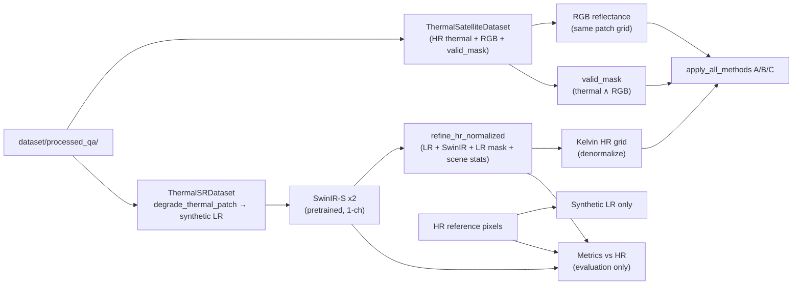

# Final reproducibility and scientific-integrity audit (v1)

**Date (UTC):** 2026-10-09  
**Git HEAD:** `0542cd2b13ae184d8eeb6487d00d71180f5b14d9`  
**Evidence directory:** `outputs/final_audit_v1/` (`audit_results.json`, `frozen_hashes_evidence.json`, `frozen_baseline_snapshot.json`, `git_status_short.txt`)

This audit is read-only: no training, no retuning, no modification of frozen evaluation JSON, split manifest, checkpoints, or prior evaluation trees.

---

## 1. Project architecture and data flow



**Scene split (frozen):** `dataset/splits/scene_split_qa_v1.json` — Kerala validation; Deccan + Assam locked test.

**Primary packages:** `dataset_loader/`, `sr_data/`, `evaluation/`, `colorization/`, `pipeline/`.

---

## 2. Exact experimental configuration (frozen)

| Parameter | Value | Source |
|-----------|--------|--------|
| Processed data | `dataset/processed_qa/` | manifests / `FrozenExperimentConfig` |
| Split | `scene_split_qa_v1.json` | sha256 in `frozen_hashes_evidence.json` |
| Degradation | scale 2, blur σ 1.2 HR px, area downsample, 0.05 K noise, `base_seed=42` | `sr_data/metadata.py` `DegradationConfig`; `pipeline/frozen_config.py` |
| Refinement β | **1.0** (frozen) | `outputs/evaluation/physics_refinement_v1/METHOD.txt` |
| SwinIR | lightweight x2 pretrained DIV2K → 1-channel | `pretrained/swinir/002_lightweightSR_DIV2K_s64w8_SwinIR-S_x2.pth` |
| Colormap | inferno, 295–320 K | `pipeline/frozen_config.py`, colorization v1 manifest |
| Guided filter | radius 8, ε 0.02, edge_mix 0.35 | same |
| Overlay | thermal_weight 0.55 | same |
| Eval / colorization seed | 42 | standalone manifest; `FrozenExperimentConfig.eval_seed` |

---

## 3. Phase 1 — Colorization regression (standalone vs integrated)

**Paths**

- Standalone: `outputs/colorization/guided_colorization_v1/patches/patch_<id>/`
- Integrated: `outputs/integrated_pipeline_v1/patches/LC08_L2SP_144053_20250225_02_T1/patch_<id>/`

**Patches:** `000096`, `000448`, `001006`, `001116` (Kerala validation scene).

### 3.1 Kelvin arrays

Compared `thermal_kelvin.npy` (standalone) vs `thermal_kelvin_refined.npy` (integrated), pixel-wise with exact equality (`rtol=0`, `atol=0`).

| Patch | Max \|ΔK\| | Differing pixels | Match |
|-------|------------|------------------|-------|
| 000096 | 0.0 | 0 / 65536 | yes |
| 000448 | 0.0 | 0 / 65536 | yes |
| 001006 | 0.0 | 0 / 65536 | yes |
| 001116 | 0.0 | 0 / 65536 | yes |

**Conclusion:** Integrated and standalone inference paths produce **identical** refined Kelvin fields for all four patches.

### 3.2 Valid masks

Standalone colorization v1 did **not** persist `valid_mask.npy`. Integrated saves `valid_mask.npy` from `predict_refined_thermal_kelvin` (`ThermalSatelliteDataset` combined mask).

| Patch | Integrated valid pixels | Standalone manifest valid_pixels | Count match |
|-------|-------------------------|-----------------------------------|-------------|
| 000096 | 64720 | 64720 | yes |
| 000448 | 65536 | 65536 | yes |
| 001006 | 65536 | 65536 | yes |
| 001116 | 65536 | 65536 | yes |

**Verified:** Count agreement on all four patches. **Not verified in this audit:** bitwise `.npy` mask file equality (standalone file absent). **Assumption:** Same loader path implies identical mask arrays (both call `predict_refined_thermal_kelvin`).

### 3.3 Decoded PNG pixels (not file hashes)

| Asset class | Result |
|-------------|--------|
| `A_standard_colormap.png`, `B_rgb_guided.png`, `C_rgb_overlay.png` | **Exact pixel match** (0 differing values) on all 4 patches |
| `*_legend.png` | **Differ** (~9.2k–11.7k differing pixel values per legend image) |

**Diagnosis (not an algorithm mismatch):** Legend figures are re-rendered by matplotlib and include **title text**. Standalone titles: `"{key} — patch {id}"` (`scripts/run_guided_colorization_v1.py`). Integrated titles: `"{label} patch {id}"` (`pipeline/integrated.py`). Method PNGs are saved with PIL from the same RGBA arrays after identical `apply_all_methods`; Kelvin identity above confirms the underlying science path matches.

**Minor note:** Residual matplotlib/font anti-aliasing could add small legend differences even if titles were aligned; titles alone are sufficient to explain observed diffs.

---

## 4. Phase 2 — Frozen artifact integrity

### 4.1 Four frozen `results.json` + split

Current SHA-256 recorded in `outputs/final_audit_v1/frozen_hashes_evidence.json`. Compared to:

- `outputs/final_audit_v1/frozen_baseline_snapshot.json` (written on first audit run this session): **no drift**
- `outputs/evaluation/physics_refinement_v1/frozen_integrity_before_test.json` (4 files, uppercase hex): **no drift** after case-normalized compare

| File | Size (bytes) |
|------|----------------|
| `outputs/evaluation/multiscene_qa_v1/validation/results.json` | 9217 |
| `outputs/evaluation/multiscene_qa_v1/test_locked/results.json` | 11079 |
| `outputs/evaluation/physics_refinement_v1/validation/results.json` | 12452 |
| `outputs/evaluation/physics_refinement_v1/test_locked/results.json` | 17320 |
| `dataset/splits/scene_split_qa_v1.json` | 4269 |

**Note:** The pre-test integrity snapshot did not include `physics_refinement_v1/test_locked/results.json`; that file is included in the audit baseline snapshot taken after locked test completion.

### 4.2 Checkpoints (hashes recorded, not “frozen” by prior snapshot)

Listed in `audit_results.json` → `phase2_frozen_integrity.checkpoints` (pretrained SwinIR `.pth`, local `.pt` training artifacts).

### 4.3 Overwrites

No audit action modified files under `outputs/evaluation/multiscene_qa_v1/`, `outputs/evaluation/physics_refinement_v1/`, or `dataset/processed_qa/`. New content is limited to `outputs/final_audit_v1/`, `outputs/integrated_pipeline_v1/`, and `outputs/colorization/` (from earlier prototype runs).

### 4.4 Git status

Captured verbatim in `outputs/final_audit_v1/git_status_short.txt`. Repository shows legacy deleted paths (`evaluation/`, `training/`, etc.) and large untracked prototype trees; **not cleaned or reset** per audit constraints.

---

## 5. Phase 3 — Scientific-integrity review (code-backed)

| Claim | Status | Evidence |
|-------|--------|----------|
| HR reference used to synthesize LR and to score predictions | **Verified** | `sr_data/dataset.py`: `degrade_thermal_patch(hr_t, hr_mask, …)` builds LR; `evaluation/metric_core.py`: `denormalize_kelvin` on HR vs prediction for MAE/RMSE |
| HR **not** passed into refinement correction | **Verified** | `refine_hr_normalized(swinir_z, lr_z, lr_valid, stats, config)` — `sr_data/consistency_refinement.py`; module docstring: “Does not read reference HR pixels” |
| HR **not** used as colorization thermal input | **Verified** | `colorization/thermal_predict.py`: SwinIR + refine + denormalize only; `colorization/pipeline.py`: no HR symbols; `pipeline/integrated.py` sets `thermal_not_hr_reference: True` |
| Kelvin conversion uses scene-specific mean/std | **Verified** | `refine_hr_normalized` uses `stats.std` / `stats.mean`; `dataset_loader/physical.py` denormalize; metrics use per-scene stats in `evaluate_multiscene.py` reports |
| Masks in evaluation | **Verified** | Metrics use valid HR/LR masks in `metric_core.py`; colorization uses combined `valid_mask` in `ColorizationInputs` |
| Masks in refinement | **Verified** | `lr_valid` mask in `refine_hr_kelvin`; LR mask from degradation chain |
| β, degradation, colormap match manifests | **Verified** | `METHOD.txt` β=1.0; `FrozenExperimentConfig` + colorization v1 manifest; `tests/test_integrated_pipeline.py::test_frozen_beta_from_method_txt` |
| Reports describe synthetic ×2, not real 15 m accuracy | **Verified** | e.g. `outputs/evaluation/multiscene_qa_v1/test_locked/report.txt` line 3; physics test report lines 3, 42–43 |
| RGB guidance is visualization-only | **Verified** | `outputs/colorization/guided_colorization_v1/manifest.json` limitations; `apply_all_methods` asserts Kelvin unchanged |
| Refinement = synthetic forward consistency, not radiative transfer | **Verified** | `METHOD.txt` summary; `consistency_refinement.py` header comment |

**HR separation (sanity, not a metric):** `pipeline/integrated.py::verify_prediction_not_hr_reference` — HR loaded only for audit diff vs refined Kelvin; documented in `outputs/integrated_pipeline_v1/integration_report.txt`.

**Assumptions / limitations (not fully proven by code alone):**

- Real TIRS PSF, atmosphere, emissivity not modeled (`METHOD.txt`, report LIMITATIONS).
- Only three QA scenes; locked test is a one-time report, not population inference.
- Pretrained SwinIR not thermally fine-tuned on this data.
- Raster I/O equivalence audited on reference scene only (multiscene report LIMITATIONS).

---

## 6. Frozen validation and test metrics (from existing reports only)

Values copied from `report.txt` files; not recomputed in this audit.

### 6.1 Multiscene baseline (`multiscene_qa_v1`)

**Validation (Kerala, 551 non-overlapping patches)** — SwinIR vs bicubic, pooled Kelvin RMSE **0.3374 K** (SwinIR) vs **0.3507 K** (bicubic).

**Locked test (Deccan + Assam, 1165 patches)**

| Scene | Method | RMSE (K) |
|-------|--------|----------|
| LC08 Deccan | bicubic | 0.3796 |
| LC08 Deccan | swinir_pretrained | 0.3677 |
| LC09 Assam | bicubic | 0.2405 |
| LC09 Assam | swinir_pretrained | 0.2349 |
| **Pooled** | swinir_pretrained | **0.3085** |

### 6.2 Physics consistency refinement (`physics_refinement_v1`, β=1.0)

**Validation (Kerala, 414 held-out patches)** — refined pooled RMSE **0.2897 K** vs SwinIR **0.3406 K**.

**Locked test (same test scenes, 1165 patches)**

| Scene | swinir_pretrained RMSE (K) | swinir_consistency_refined RMSE (K) |
|-------|------------------------------|-------------------------------------|
| Deccan | 0.3677 | 0.2772 |
| Assam | 0.2349 | 0.1969 |
| **Pooled refined** | — | **0.2404** |

---

## 7. Colorization methods and limitations

| Method | Role | Limitation |
|--------|------|------------|
| A — standard colormap | Fixed 295–320 K inferno | Display scale arbitrary; not physical retrieval |
| B — RGB-guided | Edge-aware visualization | RGB is 30 m reflectance; not 15 m thermal truth |
| C — RGB overlay | Blended display | Same physical mismatch as B |

Manifest limitations: `outputs/colorization/guided_colorization_v1/manifest.json` (`limitations` array).

---

## 8. Test commands and results (this audit session)

```text
py -m scripts.final_audit_v1
# kelvin_all_match: true; method_png_all_match: true; legend_png_all_match: false (title strings only)

py -m pytest tests/test_integrated_pipeline.py tests/test_colorization.py ^
  tests/test_consistency_refinement.py tests/test_metric_core.py tests/test_multiscene_eval.py -q
# 28 passed in ~90s (CPU)
```

**Historical reproduction commands (already run for prototype artifacts):**

```text
py -m scripts.run_guided_colorization_v1
py -m scripts.run_integrated_pipeline_v1
py -m evaluation.evaluate_multiscene --role test_locked
py -m evaluation.evaluate_physics_refinement --role test_locked
```

---

## 9. Changed files and output paths (audit scope)

| Path | Role |
|------|------|
| `scripts/final_audit_v1.py` | Audit driver (regression + integrity) |
| `outputs/final_audit_v1/*` | Evidence and this report |
| `outputs/colorization/guided_colorization_v1/` | Standalone colorization regression reference |
| `outputs/integrated_pipeline_v1/` | Integrated pipeline regression reference |

Frozen evaluation trees and split manifest: **unchanged** (hashes above).

---

## 10. Remaining scientific limitations (summary)

1. **Synthetic ×2** super-resolution against 30 m Landsat thermal as HR reference — not validated 15 m native thermal accuracy.
2. **Consistency refinement** enforces agreement with the **synthetic** blur+downsample forward model; not radiative-transfer physics.
3. **β=1.0** selected using Kerala validation patches only; locked test is report-only.
4. **Scene count** too small for geographic or seasonal generalization claims.
5. **Colorization** does not recover new thermal information; RGB guides appearance only.
6. **Legend PNG regression** is cosmetic (matplotlib titles); scientific outputs align on Kelvin and method PNG pixels.

---

## 11. Audit verdict

| Phase | Outcome |
|-------|---------|
| 1 Colorization regression (Kelvin + method PNGs + mask counts) | **Pass** |
| 1 Legend PNG pixel identity | **Expected fail** — documented title-string cause; not retuned |
| 2 Frozen `results.json` + split integrity | **Pass** |
| 3 Scientific-integrity code review | **Pass** with stated assumptions/limitations |
| 4 Documentation | **Complete** in this file + machine-readable `audit_results.json` |

**No integrity failure requiring artifact repair.** Standalone and integrated pipelines are reproducibly aligned on thermal science outputs for the audited Kerala patches.
